<div align="center">

# Gokul Ramachandran

### Building software today. Securing systems tomorrow.

<p>
  <strong>Computer Science Engineering student at VIT Chennai · Class of 2028</strong>
</p>



<p>
  <a href="https://www.linkedin.com/in/gokul-ramachandran-513299327/">LinkedIn</a>
  ·
  <a href="https://github.com/gokulra2006-del/Portffolio">Portfolio</a>
  ·
  <a href="mailto:gokulra2006@gmail.com">Email</a>
</p>

</div>

---

## A little about me

Hi, I'm **Gokul** 👋

I'm a developer who enjoys building practical products at the intersection of **full-stack engineering, AI, and cybersecurity**. I like taking an idea from a rough concept to a working application—and then improving it through better UX, cleaner code, and stronger system design.

- 🧑‍💻 Full-Stack Web Development Intern at **Incrix Techlutions LLP**
- 🏆 **2nd place** at the HackWarts Hackathon
- ☁️ Exploring **AWS, Linux, networking, Docker, and cloud security**
- 🎯 Looking for opportunities in **software engineering, cloud, and cybersecurity**

> Build with purpose. Learn in public. Improve every day.

## Things I build

<div align="center">

| 🛠️ Full-stack products | 🤖 Intelligent tools | 🛡️ Security-minded systems |
| :---: | :---: | :---: |
| User-focused web apps, APIs, authentication, and databases | AI-assisted workflows and computer-vision applications | Monitoring, incident response, emergency systems, and cloud-security foundations |

</div>

## Featured work

| Project | What it does | Built with |
| :--- | :--- | :--- |
| [**Organic Store**](https://github.com/gokulra2006-del/organic-store) | Complete e-commerce experience with cart, orders, authentication, and payments | React · Node.js · Express · MongoDB |
| [**VigiloraAI**](https://github.com/gokulra2006-del/VigiloraAI) | Visual monitoring and incident management with AI assistance | React · FastAPI · Python · Computer Vision |
| [**Crisis Alert System**](https://github.com/gokulra2006-del/Alert-System) | Emergency SOS, incident mapping, and role-based dashboards | React · TypeScript · Firebase |
| [**CodeReview AI**](https://github.com/gokulra2006-del/codereview-ai) | An exploration of AI-assisted code review | React · Vite |
| [**AI MSME Compliance Assistant**](https://github.com/gokulra2006-del/ai-msme-compliance-assistant) | An applied AI workflow for compliance support | AI · Applied Software |

<p align="center">
  <a href="https://github.com/gokulra2006-del?tab=repositories">View all repositories →</a>
</p>

## Tools I use

<div align="center">


<br />


<p><em>Currently exploring cloud operations, automation, and security engineering.</em></p>

</div>

## What I'm learning now

```text
Full-Stack Engineering  →  Cloud Operations  →  Cloud Security

Linux & networking        AWS & IAM
Security monitoring       Python & Bash automation
Docker & CI/CD            Infrastructure fundamentals
```

## Let's connect

If you're interested in **building useful products, cloud technology, cybersecurity, or student opportunities**, I'd be happy to connect.

<p align="center">
  <a href="mailto:gokulra2006@gmail.com">
    
  </a>
  <a href="https://www.linkedin.com/in/gokul-ramachandran-513299327/">
    
  </a>
</p>

<div align="center">

---

<sub>Learn · Build · Secure · Improve</sub>

</div>
